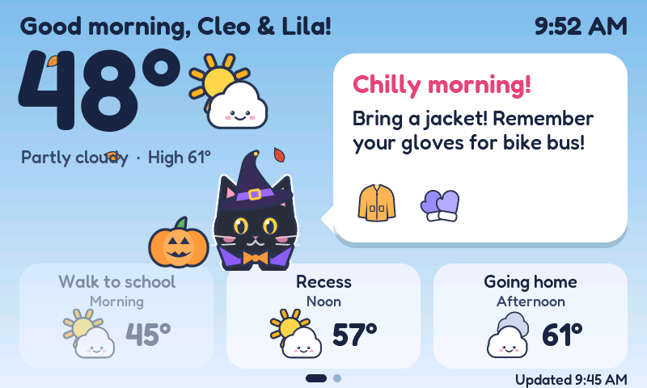
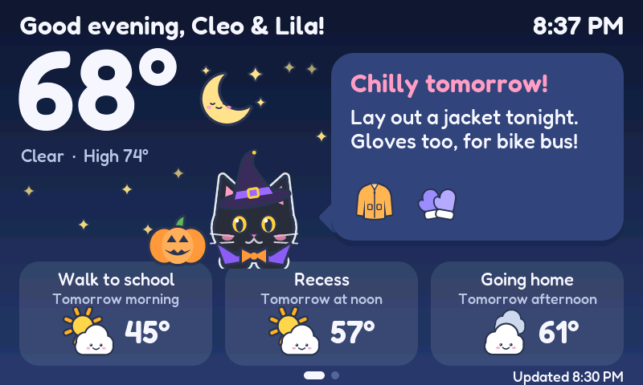
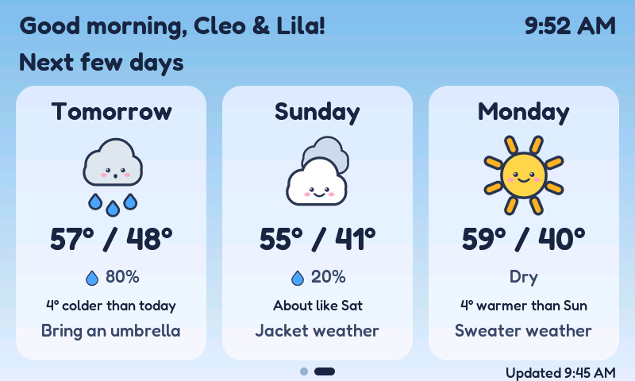
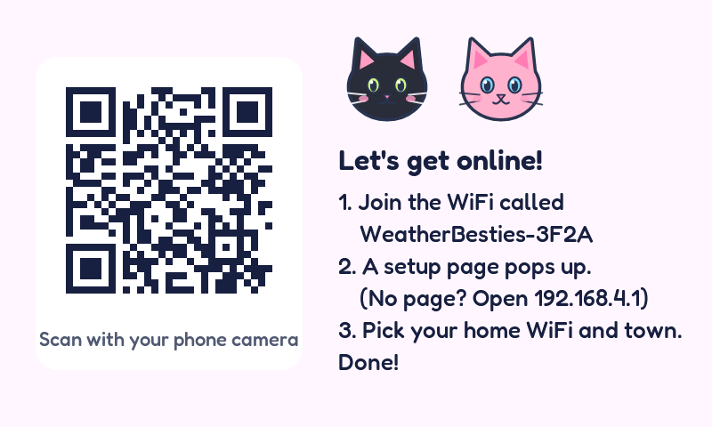

# Weather Besties

A weather station for Cleo and Lila, made for the two moments that decide what they wear: **bedtime and wake-up**.

Built on the Waveshare ESP32-S3-Touch-LCD-4.3 (800 x 480 touch screen), it lets them check the night before, lay out the right clothes, then wake up and see at a glance whether the day is going to be cold, warm, wet, snowy, or something else entirely.



## The idea

This is not a general weather dashboard. It answers one kid-sized question in words and pictures they can understand on their own:

**What kind of clothes do I need?**

- **The night before:** after 7 PM, the advice switches to tomorrow, so they can lay out clothes before bed.
- **In the morning:** they can see right away if it is going to be cold, rainy, snowy, or warm, and whether yesterday's plan still works.

## What it shows

- **Top left:** the weather right now in big friendly type, a weather picture, and one line like "Partly cloudy · High 61°".
- **Middle:** a black cat with yellow eyes, dressed for the day, and a speech bubble that is the cat talking: "Chilly morning! Bring a jacket!" with pictures of what to wear (jacket, beanie, mittens, umbrella, boots...), picked from feels-like temperature, rain, snow, storms, and sun.
- **Bottom:** the school day in their words: **Walk to school** (8 AM), **Recess** (noon), **Going home** (3 PM). Swipe left for the next three days.
- Weather moves behind the today page: rain, snow, sleet, thunderstorms, autumn leaves on fall days, stars on clear nights.
- The cat dresses up for October (witch hat and a jack-o'-lantern), Hanukkah (scarf and a menorah that gains a candle each night), and Christmas (Santa hat and a present). Otherwise it dresses for the weather.
- After 7 PM the bubble switches to tomorrow, so they can lay out the right clothes before bed.
- **Bike bus day** (Friday by default): if the 8 AM feels-like is 50°F or below, the bubble reminds everyone to wear gloves for bike bus. The evening before, it says to lay them out.
- An optional "screen off at night" mode. A tap wakes the screen for a minute.




Weather data comes from [Open-Meteo](https://open-meteo.com): free for non-commercial use, no API key, up to 10,000 calls a day. The board refreshes every 15 minutes (96 calls a day).

## The case and the insides


- **The case:** [cad/](cad/) is a 3D-printable enclosure with two sculpted cats peeking over the screen, made for a Bambu P1S. Python source, print-ready STLs, a STEP file and renders. Not printed yet: measure the screen module's thickness first (see the case README).
- **How it works inside:** [docs/INTERNALS.md](docs/INTERNALS.md) draws out the board, the software layers, the setup hotspot and the flash layout. Written for v1.0, so a few numbers (image size, drawing buffer) have changed since.

## Hardware

- Waveshare ESP32-S3-Touch-LCD-4.3 (ESP32-S3-WROOM-1-N16R8: 16 MB flash, 8 MB octal PSRAM)
- 800 x 480 RGB panel with GT911 capacitive touch
- Any USB-C 5V supply. The board has two USB-C ports: **UART** (serial, used for flashing) and **USB** (native USB)

## Flash it

Both files are in `firmware/`:

- **First time (or to start fresh):** `weather-besties-v1.4.0.bin` at address `0x0`. It's the whole thing (bootloader, partition table, and app), and it wipes saved WiFi and town, so setup runs again.
- **Updates:** `weather-besties-v1.4.0-update.bin` at address `0x10000`. It only replaces the app, so WiFi and town survive. (Safe as long as the bootloader and partition layout haven't changed; every build so far shares them.)

**Chrome or Edge, no installs:** open the [esptool-js web flasher](https://espressif.github.io/esptool-js/), plug the board into the **UART** USB-C port, set Baudrate to 921600, click Connect, pick the port, set Flash Address (`0x0` or `0x10000`, see above), choose the .bin, click Program. About 20 seconds. Click **Disconnect** afterwards, or the flasher can hold the board in reset (dark screen), then press **RESET**.

**Command line:**

```
pip install esptool
python -m esptool --chip esp32s3 write_flash 0x10000 firmware/weather-besties-v1.4.0-update.bin
```

**If it won't connect:** hold **BOOT**, tap **RESET**, let go of BOOT, then try again. If no new port shows up at all, the cable may be charge-only.

## First start

1. The screen shows a QR code and a hotspot name like `WeatherBesties-3F2A`.
2. Scan the QR with a phone (or join that WiFi network by hand). A setup page pops up. If it doesn't, open `http://192.168.4.1`.
3. Pick the home WiFi, type the password, then set: town or ZIP, names for the greeting, °F or °C, bike bus day, and optional night hours. Save.
4. The board restarts, joins WiFi, and shows the weather.



Defaults if you skip things: Upper Montclair, NJ, "Cleo & Lila", Fahrenheit, bike bus on Fridays, screen always on.

## Using it

- Swipe left for the next three days, right to come back. The page flips the moment the finger lifts (no dragging: moving the whole screen under a finger is the slowest thing this chip draws). A swipe is 80 px or more sideways from where the finger went down (`on_indev()` in `ui.c`); a finger that moved that far doesn't count as a tap or a long press.
- Hold your finger on the greeting, the clock, or any empty spot for 1.5 seconds to open Settings (change WiFi or town, refresh now). Settings are stored on the board and survive reboots and app updates.
- The school-day cards: moments that already happened fade out, and after 3:30 PM the cards switch to tomorrow. Weekends, July and August, and Dec 24 to Jan 1 show Morning (9 AM), Lunchtime and Afternoon instead (`wx_kid_moments()` in `components/wb_ui/wx.c`; other days off still say "Walk to school"). The rain chance only shows at 30% or more.
- The next-days page compares each day with the one before: warmer or colder (by the daily high), sunnier or cloudier (by hours of sun). A drop of 12°F or more says "a lot colder" and adds gloves.
- Weather animations: rain, drizzle, heavy rain, sleet, snow, thunderstorms (rain plus a lightning flicker every 5-10 s), autumn leaves (Sep 22 to Nov 30), and twinkling stars on clear nights. The rules are `cat_pick_fx()` in `cat.c`; the motion is one 30 fps timer in `ui.c` (`fx_tick()`), and pieces only fall in the open sky left of the bubble and above the cards.
- With "screen off at night" on, the screen sleeps during those hours. A tap wakes it for a minute (that first tap doesn't press anything). Weather keeps updating in the background, so the morning screen is fresh.
- The cat sits on the school-day cards next to its speech bubble. It blinks, and hops when you tap it. What it wears (rules in `components/wb_ui/cat.c`):
  - **October:** witch hat, purple cape with an orange bow, and a jack-o'-lantern.
  - **Hanukkah:** blue-and-white scarf and a menorah. Candles light at 4 PM, one more each night, added from the right. Dates come from Hebcal for 2025-2035; add years to the `HANUKKAH` table after that.
  - **Dec 15-26:** Santa hat and a present. If Hanukkah overlaps, Santa hat and the menorah.
  - **Snowing right now:** snowflakes fall around the cat, whatever it's wearing.
  - **Otherwise:** dressed like the speech bubble says. Rain hat with the umbrella, pink beanie and scarf when it's cold, scarf when it's chilly, heart sunglasses on strong-sun days.

## Try it without the board

The UI, weather parsing, and advice logic are plain C with no ESP-IDF dependencies, so the exact same code runs on a PC and in a browser.

**Browser simulator:** `make web` in `sim/` writes `sim/web/site/Weather-Besties-Simulator.html`. Double-click it; it works offline. It's the board's real screen code compiled to WebAssembly. The mouse is the finger: drag sideways to swipe, click the cat to make it hop, hold the greeting 1.5 seconds for Settings. **Live weather** fetches today's forecast for Upper Montclair with the same request the board sends; the other buttons are sample days, including the holidays.

**Screenshots of every screen** (Linux, or WSL on Windows):

```
sudo apt install build-essential python3-pil
cd sim
make shots      # PNGs in sim/out/, sample forecasts generated into sim/scenarios/
```

**Rebuilding the simulator** needs [wasi-sdk](https://github.com/WebAssembly/wasi-sdk) (set `WASI_SDK` in `sim/Makefile` if it isn't at the default path), then `make shots && make web`. The plain-JavaScript fallback (`weather-besties.asm.js`, for browsers that block WebAssembly) is made with binaryen's `wasm-opt` + `wasm2js` and `web/make_fallback.py`; see the comments there. The speed meter in the simulator measures your computer, not the board.

## Speed test on the board

Tap "Updated 7:45 AM" at the bottom right. A meter appears bottom left with frames per second and CPU, and the footer shows how many screen lines are drawn per pass and how much internal RAM is free. Tap again for the old v1.3.0 settings (small drawing area, blurred bubble shadow, whole-card fading) to compare, and a third time to turn it off.

The drawing area starts at 40 lines (the same 64 KB of internal RAM v1.3.0 used). After the first successful weather download it grows to 100, 80 or 60 lines, whichever leaves at least 64 KB of internal RAM free (`board_grow_draw_buffer()` in `main/board.c`). If a download fails while free internal RAM is under 24 KB, it shrinks back. The serial log prints the free RAM after every refresh.

## Build from source

Needs ESP-IDF v5.5 (built and tested with v5.5.6).

```
idf.py set-target esp32s3
idf.py build
idf.py -p PORT flash monitor
```

Before shipping a change to the weather requests, run `make test` in `sim/`. It builds every request the board can make with the firmware's own code (`components/wb_ui/wb_request.c`) and checks it fits the HTTP client's send buffer with room to spare. That's the bug that broke v1.1.0: ESP-IDF's default send buffer is 512 bytes and the forecast request needs about 560.

Everything else is already in `components/`: LVGL 9.5.0, Espressif's GT911 touch driver, and the captive-portal DNS server from the ESP-IDF examples. Serial logs run at 115200 baud on the UART port.

## Layout

| Path | What |
|---|---|
| `main/main.c` | Boot flow, night-off power timer, speed test hook |
| `main/board.c` | Screen, touch, IO expander (backlight, touch reset), LVGL glue, the growable drawing buffer. Pins and timing from Waveshare's own demo |
| `main/net.c` | WiFi, clock (SNTP), Open-Meteo calls, refresh and retry loop |
| `main/portal.c` | Setup hotspot, captive portal, phone form |
| `main/settings.c` | Saved settings (NVS) |
| `components/wb_ui/ui.c` | All screens, the weather animations, swipes |
| `components/wb_ui/cat.c` | Picks the cat's outfit and the weather animation (holidays, weather) |
| `components/wb_ui/advice.c` | What-to-wear rules (temperature bands, rain, snow, storms, sun) |
| `components/wb_ui/wx.c` | Forecast parsing, school-day moments |
| `components/wb_ui/wb_request.c` | Builds the Open-Meteo request addresses; buffer sizes in `wb_request.h` |
| `components/lv_conf.h` | LVGL settings, shared with the PC renderer |
| `tools/icons.py` | The artwork (weather faces, clothes, cats, the cat's outfits, falling leaves), drawn as SVG |
| `tools/make_assets.py` | Turns artwork and the Fredoka font into C files |
| `sim/` | PC renderer (`make shots`), request-size test (`make test`), browser simulator in `sim/web/` (`make web`) |
| `firmware/` | Ready-to-flash images: full at `0x0`, update at `0x10000` |
| `cad/` | The 3D-printed case: CadQuery housing, sculpted cats, STLs, STEP, renders |
| `docs/` | Screenshots rendered from the UI code, and the internals write-up |

## Tweaking

- Clothing rules: the `BANDS` table at the top of `components/wb_ui/advice.c` (temperatures are feels-like in °F).
- School times and card names: `wx_kid_moments()` in `components/wb_ui/wx.c`.
- Where things sit on the today screen: `build_today()` in `components/wb_ui/ui.c`. The cat's size is `KITTY_SETS` in `tools/make_assets.py` (currently 1.5x the original drawing).
- Bike bus cutoff and "a lot colder" threshold: `BIKE_BUS_COLD_F` and `BIG_CHANGE_F` in `components/wb_ui/advice.h`.
- Colors: the theme table at the top of `components/wb_ui/ui.c`.
- Artwork: edit `tools/icons.py`, then run `python3 tools/make_assets.py` (needs `pip install resvg-py pillow pypng` and `npm install lv_font_conv` inside `tools/`).

## On the real board

Running on the Waveshare board since v1.1.1. Things learned the hard way:

- The forecast request is longer than ESP-IDF's default 512-byte send buffer (fixed in v1.1.1, guarded by `make test`).
- On a weak WiFi signal, power saving made the forecast download time out. v1.1.2 turned power saving off (the board is wall powered), allows 30 seconds, and retries after 10 seconds.
- Plugged into a computer's USB port, the WiFi signal can drop out ("can't reach weather service"). A wall charger fixed it.
- The `0x0` full image overwrites saved settings; use the update file at `0x10000`.

If the screen ever shifts sideways or flickers while WiFi is busy, lower `LCD_PCLK_HZ` in `main/board.c` from 16 MHz to 14 MHz.

## Credits

Font: Fredoka (SIL Open Font License, see `tools/fonts/OFL.txt`). Weather data: Open-Meteo.com (CC BY 4.0).
