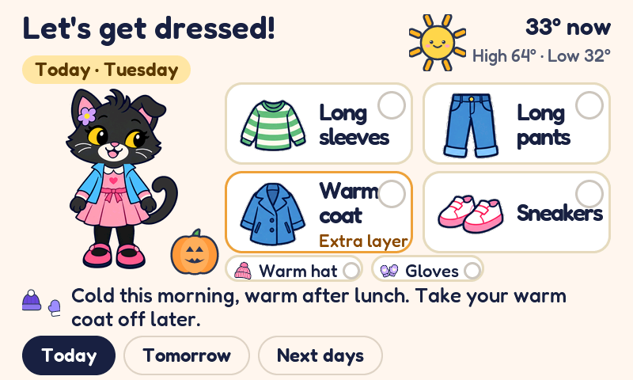
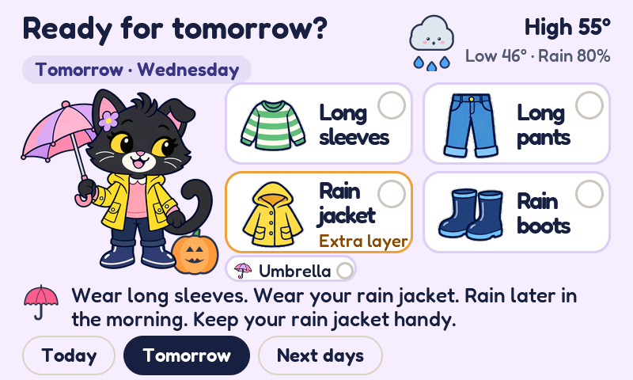
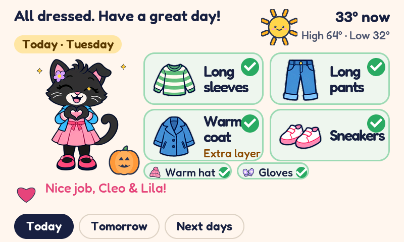
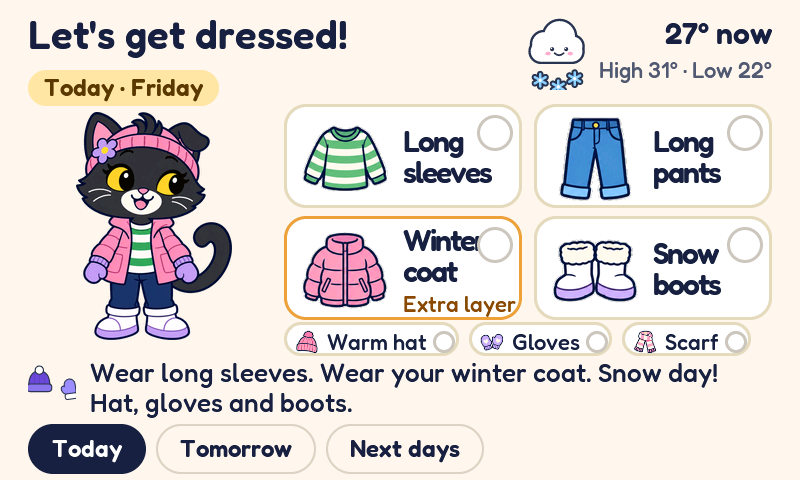
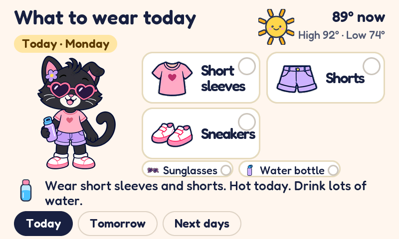
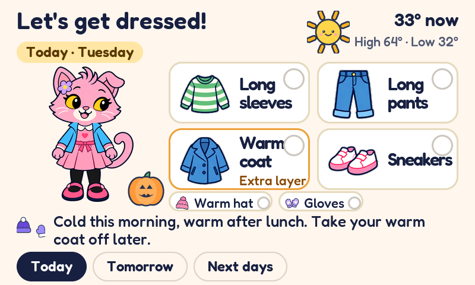
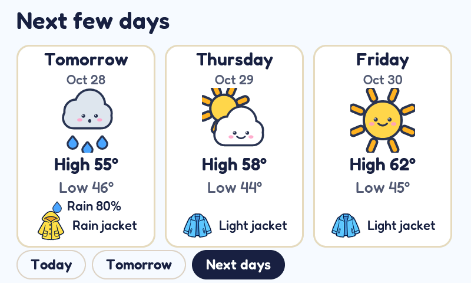
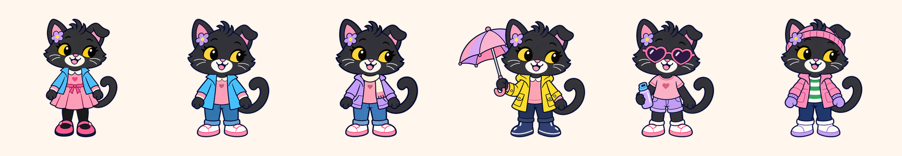
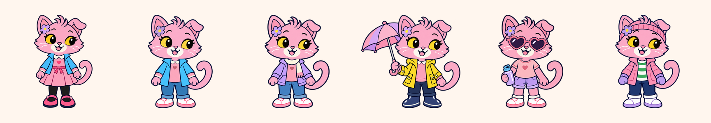
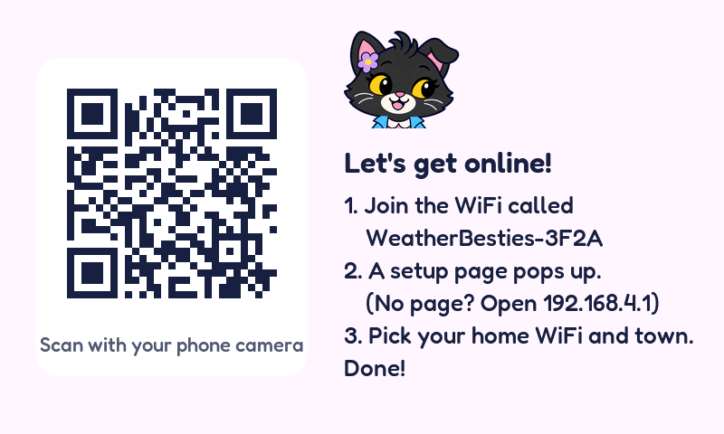

# Weather Besties

A weather station for Cleo and Lila, built around the two moments that decide what they wear: **bedtime and wake-up**.

Pippa the cat wears tomorrow's outfit, so the girls can lay out their clothes the night before, then check in the morning whether the plan still works.



## The idea

This is not a general weather dashboard. It answers one kid-sized question, in words and pictures a six-year-old can read on her own:

**What do I wear?**

- **The night before:** in the evening the screen switches to tomorrow, so the outfit gets laid out before bed.
- **In the morning:** one glance says whether it will be cold, warm, wet, or snowy, and whether yesterday's plan still works.

The design rule behind every screen: a kid should be able to look for **five seconds** and say what clothes to pick, whether she needs an extra layer, and which day the outfit is for. If a screen fails that, the screen is wrong.

## What it shows

- **Garment tiles:** big picture tiles for exactly what to wear (long sleeves, long pants, winter coat, snow boots...), picked by the outfit engine in `components/wb_ui/outfit.c` from the feels-like temperature over the school day (7 AM to 5 PM), plus rain, snow, storms, wind, and sun. Tap a tile as each item gets laid out and it turns green with a check.
- **The extra layer, in words:** when the day needs a coat on top, that tile is outlined and labeled "Extra layer". No guessing from icons.
- **Extras are check-offs too:** a warm hat, gloves, scarf, umbrella, sunglasses, or water bottle shows up as a small chip under the tiles, and it has to be checked off as well. The all-done celebration only fires when *everything* is laid out.
- **Pippa wears the prescription:** the same outfit the tiles recommend, head to toe, so the picture and the list always agree. Check everything off and she does a little heart pose: "All dressed. Have a great day!"
- **One plain sentence** under the tiles explains the day: "Cold this morning, warm after lunch. Take your warm coat off later."
- **Top right:** the weather in words a kid can use: "33° now", "High 64° · Low 32°". Tomorrow adds what matters: "Low 46° · Rain 80%".
- **Tabs at the bottom:** Today, Tomorrow, and Next days (three plain forecast cards, each with the one key garment for that day). Swipe works too. After 3 idle minutes the screen falls back to the page for the time of day.
- **Honest about stale data:** if the weather is over 90 minutes old, a chip says when it is from ("Weather from 11:45 AM"). Over 12 hours (or no data at all), Pippa shows up undressed and the screen says "I can't check the weather right now." instead of prescribing from stale numbers.
- **Little seasonal touches:** a jack-o'-lantern sits beside her in October, a menorah gains a lit candle each night of Hanukkah, and a present shows up at Christmas. A real prescription always wins: a cold Halloween still gets the winter coat.
- **Bike bus day** (Friday by default): if the 8 AM feels-like is 50°F or below, the sentence reminds everyone to lay out gloves. The evening before, it says to get them ready.
- **Your cat, your choice:** Settings (long press anywhere empty) has a cat picker: black Pippa, pink Pippa, or take turns, swapping daily. Same cat on the boot and setup screens.
- An optional "screen off at night" mode. A tap wakes the screen for a minute, and that first tap doesn't press anything.

Weather data comes from [Open-Meteo](https://open-meteo.com): free for non-commercial use, no API key. The board refreshes every 15 minutes.

## Screenshots

**Evening: tomorrow's rain outfit, ready to lay out**



**All checked off: the heart celebration**



**Snow day: winter coat, snow boots, hat, gloves, and scarf**



**Hot day: shorts, sunglasses, and a water bottle**



**Pink Pippa (Settings cat picker)**



**Next days: one key garment per day**



## Pippa's wardrobe

Six outfits, two colourways. The outfit engine prescribes; Pippa models it. From left: dress, pants, fall (hoodie and scarf), rain, hot, and snow.





## Status

The current version is **2.0.0** (the Pippa design). The screens above are rendered by the PC simulator, which runs the exact screen code the board runs, and the full UI is verified there.

Honest fine print: the prebuilt images in `firmware/` are still the older v1.4.0 build. The first flash of the 2.0.0 build onto the board is in progress; until it lands, run 2.0.0 in the simulator or build it from source (below). Everything on this page describes the 2.0.0 design.

## Hardware

- Waveshare ESP32-S3-Touch-LCD-4.3B (ESP32-S3-WROOM-1-N16R8: 16 MB flash, 8 MB octal PSRAM)
- [Buy the board on Amazon](https://a.co/d/0a7hHUrl). Tip: get the board without the case (around $37) and 3D print a case instead, see [The case and the insides](#the-case-and-the-insides) below.
- 800 x 480 RGB display with GT911 capacitive touch
- Any USB-C 5V supply. The board has two USB-C ports: **UART** (serial, used for flashing) and **USB** (native USB)

## Flash it

Flashing works the same for any build:

- **First time (or to start fresh):** the full image at address `0x0`. It's the whole thing (bootloader, partition table, and app), and it wipes saved WiFi and town, so setup runs again.
- **Updates:** the app image at address `0x10000`. It only replaces the app, so WiFi and town survive. (Safe as long as the bootloader and partition layout haven't changed; every build so far shares them.)

**Chrome or Edge, no installs:** open the [esptool-js web flasher](https://espressif.github.io/esptool-js/), plug the board into the **UART** USB-C port, set Baudrate to 921600, click Connect, pick the port, set the Flash Address (`0x0` or `0x10000`, see above), choose the .bin, click Program. About 20 seconds. Click **Disconnect** afterwards, or the flasher can hold the board in reset (dark screen), then press **RESET**.

**Command line:**

```
pip install esptool
python -m esptool --chip esp32s3 write_flash 0x10000 weather-besties-update.bin
```

**If it won't connect:** hold **BOOT**, tap **RESET**, let go of BOOT, then try again. If no new port shows up at all, the cable may be charge-only.

## First start

1. The screen shows a QR code and a hotspot name like `WeatherBesties-3F2A`.
2. Scan the QR with a phone (or join that WiFi network by hand). A setup page pops up. If it doesn't, open `http://192.168.4.1`.
3. Pick the home WiFi, type the password, then set: town or ZIP, the kids' names (used in the "Nice job" message), °F or °C, bike bus day, and optional night hours. Save.
4. The board restarts, joins WiFi, and shows the weather.



Defaults if you skip things: Upper Montclair, NJ, "Cleo & Lila", Fahrenheit, bike bus on Fridays, screen always on.

## Using it

- Tap the garment tiles and extra chips to check things off as they get laid out. The check marks belong to the outfit's day: a new day starts unchecked.
- Use the Today / Tomorrow / Next days tabs, or swipe left and right. The page flips the moment the finger lifts (no dragging: moving the whole screen under a finger is the slowest thing this chip draws). A swipe is 80 px or more sideways from where the finger went down (`on_indev()` in `ui.c`); a finger that moved that far doesn't count as a tap or a long press.
- Hold your finger on any empty spot for 1.5 seconds to open Settings (cat choice, change WiFi or town, refresh now, speed test). Settings are stored on the board and survive reboots and app updates.
- With "screen off at night" on, the screen sleeps during those hours. A tap wakes it for a minute. Weather keeps updating in the background, so the morning screen is fresh.

## The case and the insides

- **The case:** [cad/](cad/) is a 3D-printable enclosure with two sculpted cats peeking over the screen, made for a Bambu P1S. Python source, print-ready STLs, a STEP file and renders. Not printed yet: measure the screen module's thickness first (see the case README).
- **How it works inside:** [docs/INTERNALS.md](docs/INTERNALS.md) draws out the board, the software layers, the setup hotspot and the flash layout. Written for v1.0, so a few numbers (image size, drawing buffer) have changed since.

## Try it without the board

The UI, weather parsing, and outfit logic are plain C with no ESP-IDF dependencies, so the exact same code runs on a PC and in a browser.

**Browser simulator:** `make web` in `sim/` writes `sim/web/site/Weather-Besties-Simulator.html`. Double-click it; it works offline. It's the board's real screen code compiled to WebAssembly. The mouse is the finger: drag sideways to swipe, hold any empty spot 1.5 seconds for Settings. **Live weather** fetches today's forecast for Upper Montclair with the same request the board sends; the other buttons are sample days, including the holidays.

**Screenshots of every screen** (Linux, or WSL on Windows):

```
sudo apt install build-essential python3-pil
cd sim
make shots      # PNGs in sim/out/, sample forecasts generated into sim/scenarios/
```

**Rebuilding the simulator** needs [wasi-sdk](https://github.com/WebAssembly/wasi-sdk) (set `WASI_SDK` in `sim/Makefile` if it isn't at the default path), then `make shots && make web`. The plain-JavaScript fallback (`weather-besties.asm.js`, for browsers that block WebAssembly) is made with binaryen's `wasm-opt` + `wasm2js` and `web/make_fallback.py`; see the comments there. The speed meter in the simulator measures your computer, not the board.

## Speed test on the board

Open Settings (long press) and tap "Speed test". A meter appears bottom left with frames per second and CPU, and the readout in Settings shows how many screen lines are drawn per pass and how much internal RAM is free. Tap again for the old v1.3.0 settings (small drawing area, blurred shadows) to compare, and a third time to turn it off.

The drawing area starts at 40 lines (the same 64 KB of internal RAM v1.3.0 used). After the first successful weather download it grows to 100, 80 or 60 lines, whichever leaves at least 64 KB of internal RAM free (`board_grow_draw_buffer()` in `main/board.c`). If a download fails while free internal RAM is under 24 KB, it shrinks back. The serial log prints the free RAM after every refresh.

## Build from source

Needs ESP-IDF v5.5 (built and tested with v5.5.6).

```
idf.py set-target esp32s3
idf.py build
idf.py -p PORT flash monitor
```

The app partition is 7 MB (`factory` at `0x10000` in `partitions.csv`); all of the artwork together (13 Pippa sprites, the heart animation, every garment icon) takes about 2.2 MB of it.

Before shipping a change to the weather requests, run `make test` in `sim/`. It builds every request the board can make with the firmware's own code (`components/wb_ui/wb_request.c`) and checks it fits the HTTP client's send buffer with room to spare. That's the bug that broke v1.1.0: ESP-IDF's default send buffer is 512 bytes and the forecast request needs about 560.

Everything else is already in `components/`: LVGL 9.5.0, Espressif's GT911 touch driver, and the captive-portal DNS server from the ESP-IDF examples. Serial logs run at 115200 baud on the UART port.

## Layout

| Path | What |
|---|---|
| `main/main.c` | Boot flow, night-off power timer, speed test hook |
| `main/board.c` | Screen, touch, IO expander (backlight, touch reset), LVGL glue, the growable drawing buffer. Pins and timing from Waveshare's own demo |
| `main/net.c` | WiFi, clock (SNTP), Open-Meteo calls, refresh and retry loop |
| `main/portal.c` | Setup hotspot, captive portal, phone form |
| `main/settings.c` | Saved settings (NVS) |
| `components/wb_ui/ui.c` | All screens: outfit pages, forecast page, settings, swipes |
| `components/wb_ui/outfit.c` | The outfit engine: what-to-wear rules over the school-day window (feels-like bands, rain, snow, storms, wind, sun) and the advice sentences |
| `components/wb_ui/cat.c` | The seasonal props that sit beside Pippa (pumpkin, menorah, present) |
| `components/wb_ui/wx.c` | Forecast parsing (hourly wind gusts feed the outfit engine's windy rule) |
| `components/wb_ui/wb_request.c` | Builds the Open-Meteo request addresses; buffer sizes in `wb_request.h` |
| `components/lv_conf.h` | LVGL settings, shared with the PC renderer |
| `tools/make_pippa_assets.py` | Turns the Pippa sprites (six outfits x two colourways, the base, the heart animation) into LVGL C arrays |
| `tools/crop_garment_sheet.py` | Crops the garment icons out of the icon sheet in `tools/garment_sheet/` |
| `tools/icons.py` | The remaining artwork (weather faces and small icons), drawn as SVG |
| `tools/make_assets.py` | Turns artwork and the Fredoka font into C files |
| `sim/` | PC renderer (`make shots`), request-size test (`make test`), browser simulator in `sim/web/` (`make web`) |
| `firmware/` | Ready-to-flash images: full at `0x0`, update at `0x10000` (still v1.4.0, see Status) |
| `cad/` | The 3D-printed case: CadQuery housing, sculpted cats, STLs, STEP, renders |
| `docs/` | Screenshots of the current design in `docs/screens/`, and the internals write-up |

## Tweaking

- Clothing rules: `components/wb_ui/outfit.c` (thresholds are feels-like in °F; the school-day window and departure hour are at the top of `outfit_make()`).
- Where things sit on the outfit pages: `build_outfit_page()` and `render()` in `components/wb_ui/ui.c`. Pippa's stage is 260x252; her sprites are full-body pictures swapped whole, never layered.
- Bike bus cutoff: `BIKE_BUS_COLD_F` in `components/wb_ui/outfit.h`.
- Colors: the palette at the top of `components/wb_ui/ui.c`.
- Artwork: Pippa sprites are finished pictures, converted by `tools/make_pippa_assets.py`. The SVG artwork (weather faces, icons) lives in `tools/icons.py`; run `python3 tools/make_assets.py` after changing it (needs `pip install resvg-py pillow pypng` and `npm install lv_font_conv` inside `tools/`).

## On the real board

The v1 firmware ran on the Waveshare board from v1.1.1 on. Things learned the hard way, still true for 2.0:

- The forecast request is longer than ESP-IDF's default 512-byte send buffer (fixed in v1.1.1, guarded by `make test`).
- On a weak WiFi signal, power saving made the forecast download time out. v1.1.2 turned power saving off (the board is wall powered), allows 30 seconds, and retries after 10 seconds.
- Plugged into a computer's USB port, the WiFi signal can drop out ("can't reach weather service"). A wall charger fixed it.
- The `0x0` full image overwrites saved settings; use the update file at `0x10000`.

If the screen ever shifts sideways or flickers while WiFi is busy, lower `LCD_PCLK_HZ` in `main/board.c` from 16 MHz to 14 MHz.

## Credits

Font: Fredoka (SIL Open Font License, see `tools/fonts/OFL.txt`). Weather data: Open-Meteo.com (CC BY 4.0).
