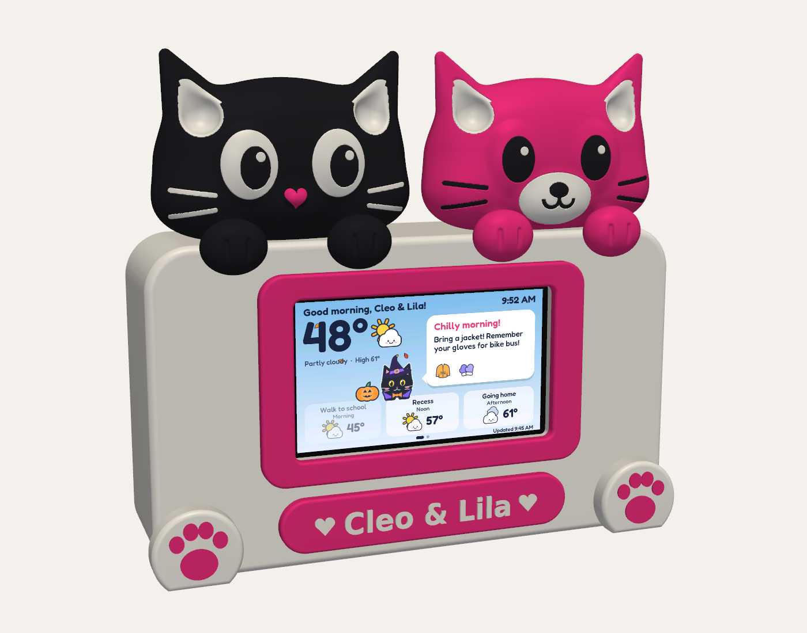

# Weather Besties enclosure, Rev C (sculpted cats)

Parametric CadQuery model for a Waveshare ESP32-S3-Touch-LCD-4.3 (touch version). 200 x 180 x 48 mm overall (paws and feet add ~8 mm in front).

## Files
- `out/weather_besties_assembly.step`: full colored assembly, opens in Fusion, Onshape, FreeCAD. Includes a reference screen block (REF_*) that is not printed.
- `out/print/`: STLs already oriented for the P1S. Multi-color parts share one coordinate frame.
- `weather_besties.py`: housing source (CadQuery). `sculpt_cats.py`: the sculpted cats (blended 3D shapes, meshed at 0.3 mm).
- Rebuild everything: `python3 weather_besties.py && python3 export_print.py && python3 sculpt_cats.py`
- The STEP has the housing only. The cats are organic meshes, so they ship as STL (import them into Fusion as mesh bodies if you want to see them in the assembly).

## Renders
`python3 render.py` writes offscreen VTK renders into `out/`: `preview_front`, `preview_back`, `preview_exploded`, `preview_inside`, `preview_cats_side`, plus `concept_front` and `concept_straight`, which put the simulator's today screen (`../sim/out/03_today_oct_morning.png`) on the glass at the real 95.5 x 54.4 mm active area.

Needs Python with `cadquery`, `numpy`, `scikit-image`, `trimesh` and `vtk`.

## Printing (P1S, PLA or PETG, 0.2 mm layers)
| File | Orientation | Notes |
|---|---|---|
| 01_shell | front face down | no supports needed |
| 02_back_cover, 03_screen_retainer | flat | |
| 04_bezel | back down | pink |
| 05_nameplate (2 parts) | back down | pink plate + white text |
| 06/07 feet (2 parts each) | back down | white + pink pads |
| 08/09 cats (3 parts each) | flat back down, face up | sculpted, about 30 mm deep. Paws hang below the head: enable tree supports, paint them under the paw tips only. Use 0.12 mm layers for smoother domes |

Multi-color: select all STLs for one group, drag into Bambu Studio together, and answer Yes when it asks to load them as one object with multiple parts. Then set each part's filament. The cat face colors are a 1.4 mm skin that follows the curved surface, so they need an AMS (layer-height color swaps won't work on a dome).

## Hardware
- 8x M3 x 8 self-tapping (back cover and screen retainer)
- 8x M3 x 6 self-tapping (bezel x4, nameplate x2, feet x2, driven from inside before the screen goes in)
- Thin foam tape on the 4 retainer pads
- Right-angle USB-C cable, exits through the notch at the bottom of the back cover

No glue anywhere. Cats push into square sockets on top of the shell.

## Assembly order
1. Screw bezel, nameplate and feet on from inside the empty shell.
2. Push the cats into the top sockets.
3. Drop the screen in glass-first; the rim locates it.
4. Foam on the retainer pads, screw retainer to its 4 bosses (optionally screw through the board's own holes too).
5. Plug in USB-C, route cable down, screw on back cover.

## Verify before printing (not confirmed from Waveshare docs)
- `MODULE_T = 7.5`: glass front to PCB back face. Measure with calipers. If wrong, the retainer will be loose or crack the board.
- Back-side component heights: retainer frame sits about 6.8 mm off the PCB. Anything taller under the frame band needs `PAD_H` raised.
- Visible area offset: window is 100 x 58 centered on the glass. If the active pixels are off-center, shift `WIN_*` or `SCREEN_*`.
- USB-C position and plug clearance: about 22 mm of clear depth behind the retainer.
- Print a test strip with one M3 pilot and one cat socket before committing to the shell.
