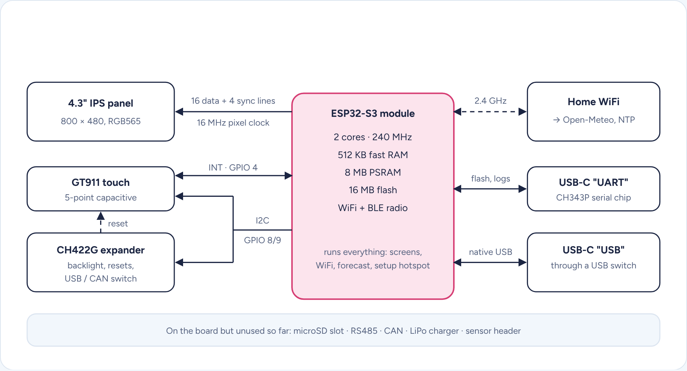
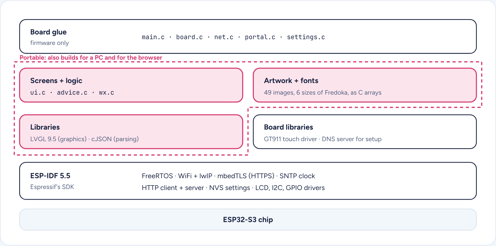
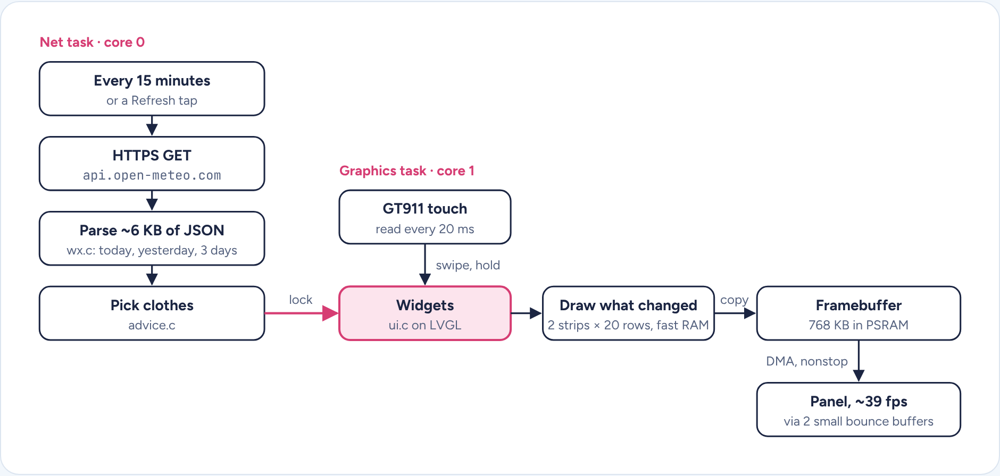
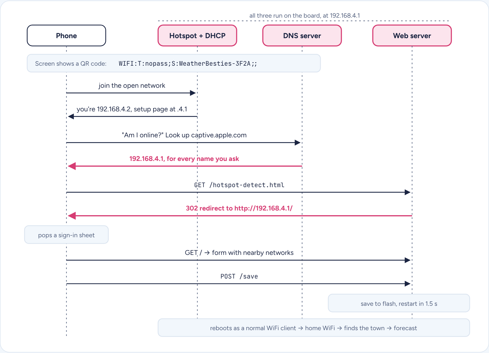
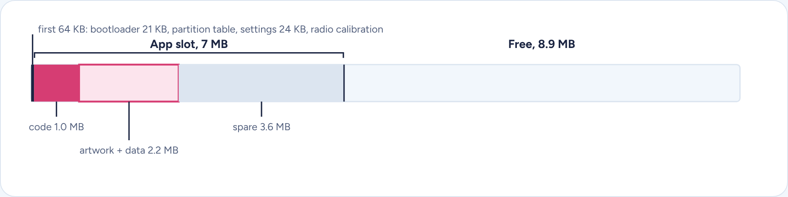
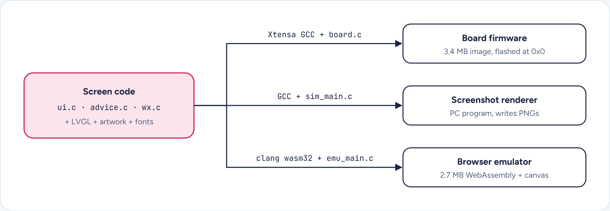

# Weather Besties Internals

A 4.3-inch touchscreen weather station that tells two kids what to wear. One C program on a small microcontroller board: no Linux, no app store, just firmware that fetches a forecast every 15 minutes and draws it.

The same page with live diagrams: [internals.html](internals.html) (open it from GitHub Pages or download it).

## The board

It's a Waveshare ESP32-S3-Touch-LCD-4.3: an Espressif ESP32-S3 module soldered behind a 4.3-inch touchscreen, with the support chips a smart display needs. Think of it as a tiny all-in-one: WiFi, a CPU, memory and a screen on one card, powered over USB-C.

| Chip | Memory | Screen | Touch |
|---|---|---|---|
| **ESP32-S3** 2 cores at 240 MHz, WiFi 2.4 GHz and Bluetooth LE | **512 KB fast RAM** plus 8 MB slower RAM (PSRAM) and 16 MB flash | **800 × 480 IPS** 16-bit color over a parallel RGB bus | **GT911 controller** 5-point capacitive, talks over I2C |

Everything hangs off one ESP32-S3. The panel has no memory of its own, so the chip streams raw pixels at it nonstop. Touch and the IO expander share one I2C bus, and the expander is how the firmware turns on the backlight and resets the touch chip at boot.

## Hardware and software split

It's all one C program, built with Espressif's ESP-IDF framework. The screens and the clothing logic never touch hardware directly. They only talk to LVGL, a C graphics library, and to plain data structs. The board-specific code is a thin layer of about five files.

The pink, dashed region compiles anywhere a C compiler does. Swap the board glue for a different file and the same screens run on a laptop or in a web page, pixel for pixel.

## What runs while it's on

FreeRTOS gives the program tasks, timers and locks, and nothing else. Two tasks do the real work, one per CPU core, and a lock keeps them from touching the screen at the same time.

The screen hardware reads the 768 KB framebuffer over and over (16 MHz ÷ 820 × 500 clocks per frame ≈ 39 frames a second), so the CPU only redraws the parts that change. The clock comes from internet time (SNTP) plus the time-zone offset the forecast reports, which handles daylight saving for free.

## The setup hotspot

The board has no keyboard, so setup happens on your phone. On first boot (or from Settings) the board stops being a WiFi client and becomes a tiny open WiFi network called `WeatherBesties-XXXX`, the last 4 characters from its radio's hardware address. Three small servers on the board then trick the phone into opening the setup page automatically, the same way hotel and airport WiFi do.

The pink answers are the whole trick. A DNS server that answers every lookup with the board's own address, plus a web server that redirects any unknown page to the form, makes the phone's "am I online?" check fail in exactly the way that pops a sign-in sheet. The DHCP reply also carries the setup address directly (the newer "captive portal" DHCP option), for phones that look for it.

- **Scanning while hosting.** The radio runs as hotspot and client at once, so the client side can scan for nearby networks to list on the form.
- **The QR code** is the standard WiFi QR format phone cameras already understand, so there's no network name to type.
- **Security, plainly.** The hotspot is open, but it only exists during setup. The home WiFi password is stored on the board's flash without encryption, which is normal for hobby boards and worth knowing.

## Where it lives in flash

The whole program is a single 3.4 MB image. Two thirds of it is artwork, fonts and other constant data, not code.

Drawn to scale across 16 MB. At boot the code and constants get copied into the 8 MB PSRAM and run from there, so saving settings to flash never makes the screen glitch.

## One screen codebase, three places it runs

Because the screens never touch hardware, the same files compile three ways. Only the small glue file changes, and that's what made the screenshots and the browser emulator possible without the board on the desk.

The icons start as SVG drawings in a Python script and get rendered and packed into RGB565 pixel arrays with an alpha channel. The Fredoka font gets rasterized into bitmap tables at six sizes. Both end up as C files, so the board never needs a filesystem or an image decoder.

---

Built on ESP-IDF 5.5.6, LVGL 9.5.0, cJSON and Espressif's GT911 driver. Pins and panel timing from Waveshare's demo code for this board. Weather from Open-Meteo.
